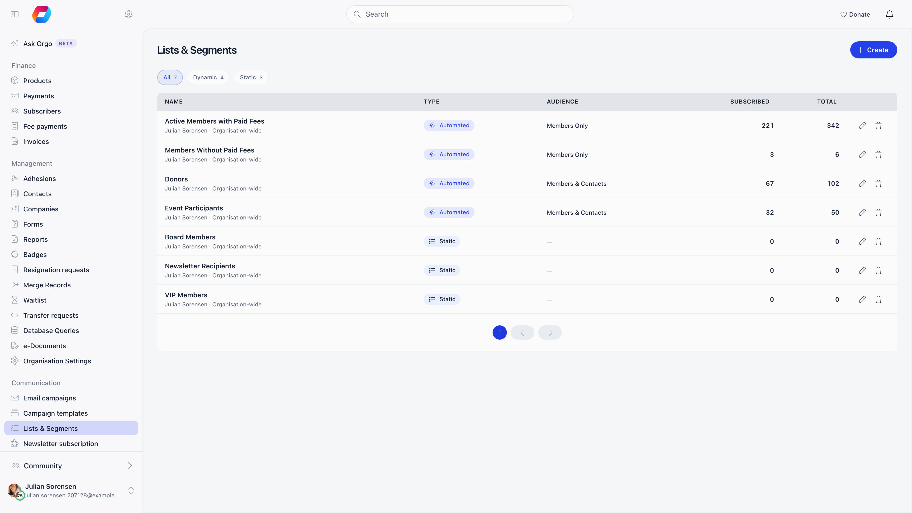
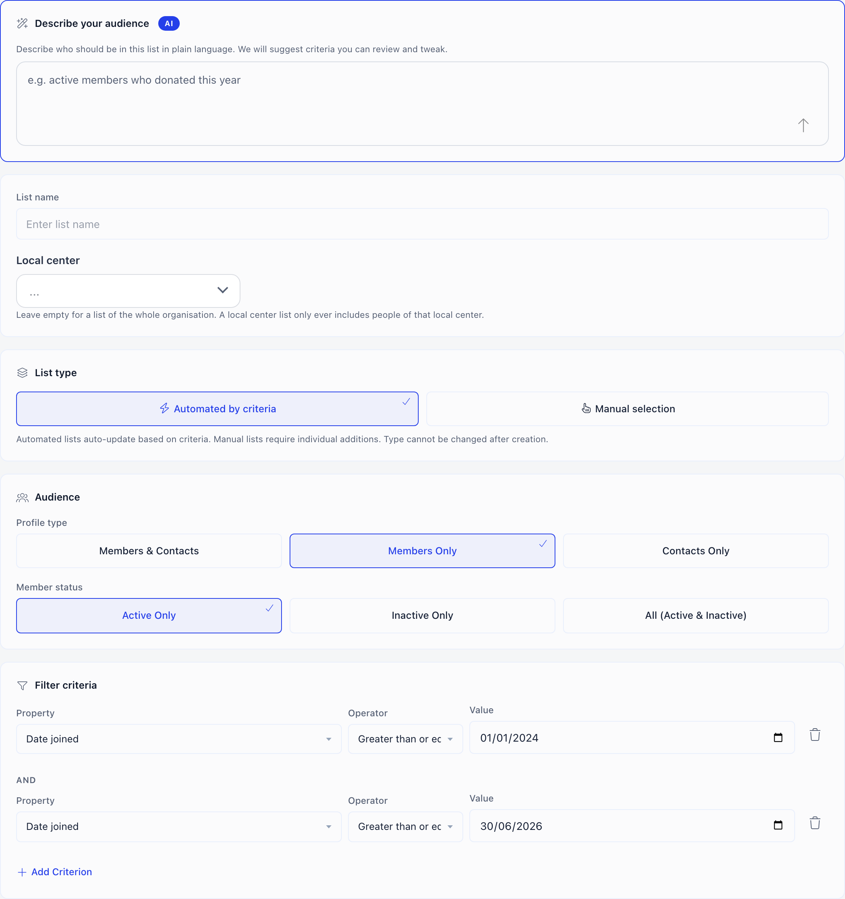
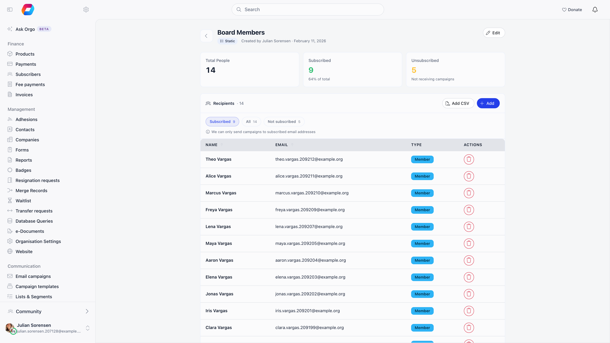

A list is a reusable set of members and contacts: everyone who joined this year
and has not paid, everyone with an active recurring donation, everyone who
attended last year's conference. Lists are what you pick as the audience when you
send a newsletter.

**Built for** organisations that send to parts of their base rather than all of
it. **Replaces** the spreadsheet you re-filter before every mailing.

Lists live under **Administration** → **Communication** → **Lists & Segments**
(`/email-lists`). They require the newsletter module. Who sees them depends on
reach:

- **Organisation-wide communication managers and HR managers** see every list and
  manage the organisation-wide ones.
- **Chapter communication managers and chapter admins** manage the lists of their
  own chapters, and read the organisation-wide lists without being able to change
  them. See [Chapter lists](#chapter-lists) below.
- **Chapter HR managers** on their own get no lists.

The index has five columns: **Name**, **Type** (Automated or Static), **Audience**
(the profile type), **Subscribed** and **Total**, plus edit and delete buttons on
each row. Under each name you see who created the list and which chapter it
belongs to, or **Organisation-wide**. A list you can read but not change carries a
**Read-only** badge and has no edit or delete buttons. Chips at the top filter to **All**, **Dynamic** or **Static**, a search
box appears once you have more than ten lists, and the table pages at 20.

---

## Two kinds of list

**Automated** lists are defined by criteria and re-evaluate themselves. Someone
who becomes eligible tomorrow is in the list tomorrow, with no action from you.

**Manual** lists contain exactly the people you put in them, and change only when
you change them.

<Warning>
The type and the audience scope are fixed when the list is created. Both controls
are locked on the edit screen. If you build a manual list and later want it to
maintain itself, create a new automated list.
</Warning>

---

## Creating a list

<Steps>
  <Step title="Describe the audience, or skip straight to criteria">
    The **Describe your audience** panel takes a plain-language description of up
    to 1000 characters, for example "active members in Norfolk who joined this
    year and have not paid", and turns it into a name, a scope and a set of criteria,
    with an estimate of how many people match. It is a starting point, not the
    saved definition: review what it produced before saving.
  </Step>
  <Step title="Name the list and pick the chapter">
    When your organisation uses local centers (chapters), the **Local center**
    field sets which chapter the list belongs to. Organisation-wide managers can
    leave it empty for a list of the whole organisation. Chapter managers must pick
    one of their own chapters. If that chapter has sub-chapters, an **Include
    sub-chapters** switch appears. See [Chapter lists](#chapter-lists).
  </Step>
  <Step title="Pick the type">
    **Automated by criteria** or **Manual selection**. This cannot be changed later.
  </Step>
  <Step title="Set the profile type">
    **Members & Contacts**, **Members Only** or **Contacts Only**. Contacts are
    people in your database who are not members: newsletter subscribers, past
    attendees, donors who never joined. See [Contacts](/platform/contacts).
  </Step>
  <Step title="Set the member status">
    **Active Only**, **Inactive Only** or **All (Active & Inactive)**. Active Only
    is the default, so a list silently excludes lapsed members until you widen it.
    This is the one audience setting you can still change after creation.
  </Step>
  <Step title="Add criteria">
    Add as many as you need. Criteria always combine with **AND**: every condition
    must be true. There is no OR and no grouping. A chapter list may have no
    criteria at all: the chapter is then the audience, and the list holds everyone
    in it who matches the profile type and member status.
  </Step>
</Steps>

<Note>
You can also start from **Ask Orgo**. When an answer there is a set of people, it
offers **Save as segment** (or **Open in editor** on a list proposal), which opens
this builder with your question already in the describe box and the suggestion
already running.
</Note>

---

## What you can filter on

Available criteria depend on the profile type, because members and contacts do
not carry the same data.

| Criterion | Members Only | Contacts, or mixed | Values |
|---|---|---|---|
| **Status** | yes | yes | One of your profile statuses, or No status |
| **Tags** | yes | yes | Has tag, Has all tags, Doesn't have tag |
| **Date joined** | yes | yes | A date, with before/after/equals comparisons |
| **Age** | yes | yes | A whole number of years, with comparisons |
| **Has Payment** | yes | yes | Has made a donation, Has never made a donation, Any payment (fees, tickets, donations), No payments of any kind |
| **Has Recurring Payment** | yes | yes | Active, past or any recurring donation, the negations of each, any active or past recurring payment, or none |
| **Event Attendance** | yes | yes | Attended any event, Never attended any event, Attended specific event, Not attended specific event |
| **Local center** | yes | yes | One or more centers, with the options listed below |
| **Valid fee date** | yes | no | A date |
| **Is full member** | yes | no | Yes or No |
| **Date joined as full member** | yes | no | A date |
| **Membership Fee Status** | yes | no | Paid, Not Paid |
| **Membership renewal** | yes | no | Renewed, Not renewed |
| **Adhesion status** | yes | no | Initiated, Pending, Success, Rejected |
| **User type** | yes | no | One or more of your user types |
| **Donation dropout** | no | Contacts Only | Started but never donated |

Some criteria only appear when the feature behind them is on:

- **Local center** appears when your organisation uses local centers. On a chapter
  list it is offered only if the list can cover more than one center, because
  otherwise there is nothing left to narrow.
- **Status** is always offered on Members Only; on the contact scopes it appears
  only when contact statuses are turned on.
- **Adhesion status** appears when the adhesion module is on.
- **User type** appears when your organisation has user types.

For the two donation criteria, picking a donation value reveals a **Product**
selector so you can narrow to one donation campaign rather than all of them.
Choosing "Attended specific event" or "Not attended specific event" reveals an
event search.

### Attended an event

**Event Attendance** counts a person only when their RSVP is marked **Attended**.
Being registered, or having RSVP'd "attending", is not enough: someone who signed
up but whose attendance was never marked, or who did not show up, does not count.
Cancelled registrations never count. So:

- **Attended any event** and **Attended specific event** match only people marked as attended.
- **Never attended any event** and **Not attended specific event** match everyone else,
  including people who registered and did not come, and people who are registered
  for an event that has not taken place yet.

If a list built on attendance looks shorter than the event's participant count,
check that attendance was marked after the event. See [Attendance](/platform/events/attendance).

### Membership renewal and adhesion status

**Membership renewal** looks at fee payments. **Renewed** means the fee is valid
today and the member has paid at least two membership fees. **Not renewed** means
they paid at least once and the fee has lapsed. First-year members and people who
never paid are in neither group, so a "not renewed" campaign reaches only lapsed
payers. Members who are exempt from the fee are left out of both.

**Adhesion status** looks at the member's current adhesion application. **Initiated**
is an application started but not yet sent. **Pending** covers every step still
under review. **Success** and **Rejected** are the final outcomes. If your adhesion
flow has no review steps, Pending is not offered. See [Adhesion](/platform/users/adhesion).

### Operators

Which comparisons you get depends on the criterion, and the **Operator** dropdown
is hidden when only one applies:

| Criterion | Operators |
|---|---|
| The dates (**Date joined**, **Valid fee date**, **Date joined as full member**) | Equals, Not equals, Greater than, Greater than or equals, Less than, Less than or equals, Is null, Is not null |
| **Age** | Choose Equals, Not equals, Greater than, Greater than or equals, Less than or Less than or equals. The other operators in the dropdown do not work on age |
| **Is full member** | Equals, Not equals |
| **Tags** | Has tag, Has all tags, Doesn't have tag |
| **Local center** | Is one of, Has no local center, Has any local center, and where your centers have a parent level: Sub-centers only, Including sub-centers |
| **User type** | Is one of |
| Everything else | Equals only |

So "under 18" or "joined after March" are comparisons rather than exact matches.
There is no free-text criterion: you cannot build a list by name or email address.

For **Local center**, **Is one of** matches people whose own center is one of those
you picked. **Sub-centers only** matches people in the centers below the ones you
picked, and **Including sub-centers** matches both. A parent center often has no
members of its own, so "Is one of" on a parent alone can come back empty: use
**Including sub-centers** when you mean the whole branch. Several centers or user
types in one criterion are combined with OR.

---

## Chapter lists

When your organisation uses local centers, a list can belong to one chapter. A
chapter list only ever contains people of that chapter, plus the people of its
sub-chapters when **Include sub-chapters** is on. Authority flows down the chapter
tree and never up or sideways, so the audience of a list cannot be wider than its
chapter and its descendants.

- **Chapter managers** (chapter communication managers and chapter admins) manage
  the lists of their own chapter, of the chapters their roles or grants give them,
  and of every sub-chapter below those. A chapter admin does not reach the parent
  chapter above their own, nor a sibling chapter. Someone with a parent-level right
  also reaches their parent chapter and everything below it.
- **Organisation-wide communication managers** reach every chapter. Chapter HR
  managers alone do not get chapter lists, and organisation-wide HR managers
  manage only the organisation-wide lists.
- **Organisation-wide lists** (no chapter) are read-only for chapter managers. They
  can open one and target it from a newsletter, but they only see the people of
  their own chapters in it, so its counts and recipients shrink to their reach.
- **Include sub-chapters** appears only when the chosen chapter has sub-chapters.
  Without it, people of the sub-chapters are not in the list.
- On a **manual** list, adding someone outside the list's chapter (and sub-chapters,
  if included) is refused, and anyone already linked who sits outside it is left
  out of counts and sends.
- If a chapter is deleted, its lists are deleted with it, rather than turning into
  organisation-wide lists.

## Working with a saved list

An automated list over members opens with four tiles: the total, how many are
**Subscribed**, how many are **Unsubscribed**, and the member status the list
applies. The total tile is labelled by what the list holds: **Total Members**,
**Total Contacts** or **Total People**. A manual list, and an automated Contacts
Only list, show the first three. A list built on **Event Attendance** shows the
total alone, because the subscribed split does not apply to it. Below them, **Active criteria** spells out
the saved definition of an automated list in plain terms, and **Recipients**
lists the people themselves.

Chips above the table switch between Subscribed, All and Not subscribed, each
with its count, on automated and manual lists alike. They are hidden on a list
built on **Event Attendance**.

Subscribed means the person explicitly opted in. Someone who never made a choice
counts as not subscribed rather than as subscribed, which is why a list you built
by hand can show a Subscribed count well below its total. Campaigns only reach
subscribed addresses, so a list whose total is much larger than its subscribed
count will send to fewer people than it appears to hold. See
[Contacts](/platform/contacts) for the three subscription states.

Lists over 100 people do not load their members automatically: use **Show
recipients**. The recipients table pages at 50 at a time.

On a manual list you also get **Add**, which searches members or contacts by name
and adds the ones you tick, a remove button per row, and, for Orgo
administrators only, **Add CSV** for bulk additions from a file. Adding someone
who is already in the list is harmless: the existing entry is kept and the row is reported as skipped rather than failing.

<Note>
Adding and removing people follows the same rule as editing the list. Organisation-wide
communication and HR managers can change organisation-wide lists, and chapter
managers can change the lists of their own chapters. If you can only read a list,
the **Add** button and the remove buttons are not shown.
</Note>

<Note>
Automated lists have no add or remove buttons. To change who is in one, change
its criteria.
</Note>

---

## A list is not the same thing as an audience

When you compose a newsletter you pick one audience, and a saved list is only one
of the choices:

| Option | Who it sends to |
|---|---|
| **All members and contacts** | Everyone subscribed in the database |
| **Members from a group** | One group |
| **All subscribed contacts** | Contacts only, no members |
| **From a list** | A saved list, the subject of this page |
| **Event attendees** | Participants of one event |
| **Non-openers of "..."** | People who did not open an earlier campaign, offered only on a follow-up |

The other five are derived from the platform's own structures and cannot be saved
or reused. Reach for a list when the audience is a question about the people
themselves rather than a group, an event or a previous campaign.

<Note>
Chapter communication managers who cannot send organisation-wide see only two
options, **Members from a group** and **From a list**. The two database-wide options
and event attendees are hidden from them. They must choose one of their chapters
for the newsletter, and the list must belong to a chapter they manage or be an
organisation-wide list.
</Note>

Choose **From a list** and pick the list. The count shown next to the option is
the subscribed count, not the total.

For an automated list, the audience is resolved again when the newsletter is
actually sent, so people who became eligible after you drafted it are included and
people who no longer qualify are not. Two boundaries then apply together: the
list's own chapter (and its sub-chapters if included), and the chapter the
newsletter belongs to. The audience is the overlap of the two, so a list cannot be
used to reach people outside either.

<Note>
Including sub-chapters is set separately on the list and on the newsletter. A list
that covers a chapter and its sub-chapters, sent in a newsletter of that chapter
with **Include sub-chapters** off, reaches only the chapter's own people. When you
pick a chapter list in the newsletter form, the chapter and the switch are filled
in from the list.
</Note>

If a scheduled newsletter's owner has lost their reach over the list's chapter by
the time it is due, the send is stopped rather than going out wider than they are
allowed.

One exception is worth knowing: a list built on **Event Attendance** ignores the
subscribed and unsubscribed split entirely, because event mail is treated as
informational rather than marketing.

---

## Deleting a list

**Delete** asks for confirmation and first checks where the list is used. Deleting
a list removes the list and its member links, and nothing else:

- Newsletters that were sent to it are kept, with their history and statistics. They
  only lose the link to the list.
- Drafts that used the list keep existing but lose their audience, so they need a
  new one before they can be sent.
- While a newsletter is **scheduled or sending** on the list, deletion is refused and
  the dialog names the campaigns. Stop or send them first, then delete.

Earlier versions deleted every newsletter addressed to the list. That no longer
happens.

---

## When a list is not enough

List criteria cover the questions organisations ask most often, and they only
combine with AND. If you need something they cannot express, such as a report
across several years of payment history, ask about custom database queries: those
are set up for your organisation and appear on the statistics page rather than
here, behind the analytics query feature and organisation-wide financial managers or
explicit query access.

---

## Related

- [Newsletter](/platform/newsletter) - composing and sending to a list
- [Users & Profiles](/platform/users) - the member directory the criteria draw on
- [Contacts](/platform/contacts) - non-member people who can be in a list
- [Custom Fields](/platform/users/custom-fields) - extra data on a profile
- [Permissions](/platform/permissions) - what organisation-wide communication and HR managers can do
