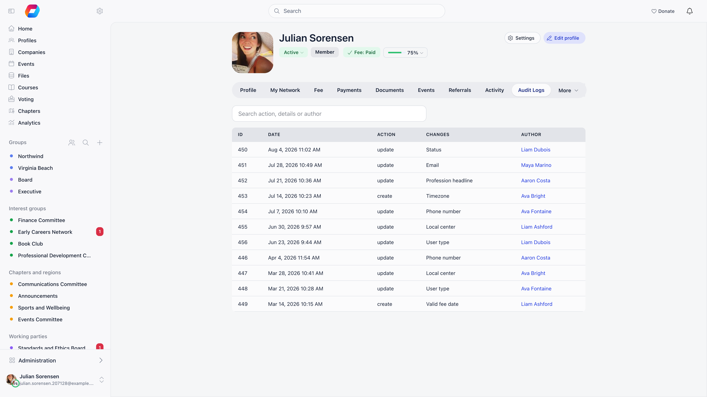
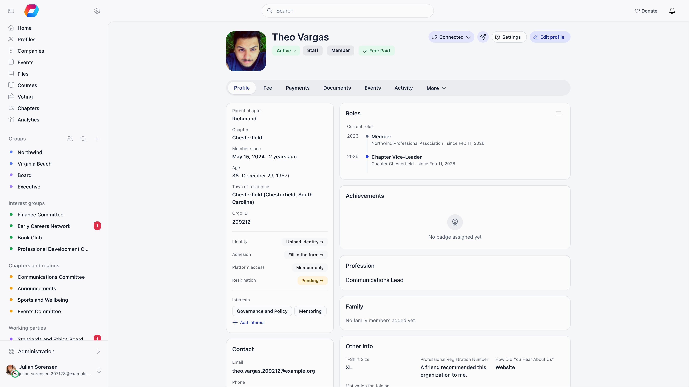

A member profile is one screen with three views. **Profile** is a set of cards you read. **Edit** is where an administrator, or the member, changes details, status, roles and permissions. **Settings** is the member's own account: notifications, privacy, password, email, timezone and closing the account. Nothing opens on a separate page: the old "Edit member" page no longer exists, and each of its tabs is now a pane of Edit or Settings.

**Built for** members who keep their own details current and for the administrators who maintain member records, roles and access. **Replaces** the retired Edit member page.

---

## Opening a profile

| From | How |
|---|---|
| The member directory | Click a name. The profile opens in a modal that you can expand to a full page. |
| Your own profile | `/me`. **Account settings** in your profile menu opens your own Settings view. |
| A direct link | `/user/{id}`. **Copy link** in the profile's action menu copies it. |
| An old link or bookmark | `/users/edit/{id}` still works and redirects to the matching view (see [Where the old edit page went](#where-the-old-edit-page-went)). |

In the directory, the row menu items **View Profile**, **Modify Profile** and **Modify Roles** (shown to `ADMIN_LOCAL` and above) open the same profile: **Modify Profile** lands in Edit on the **Info** pane, **Modify Roles** on the **Roles** pane. See [Users & Profiles](/platform/users).

---

## The header

The top of every profile carries the member's photo, name and a row of chips, with the actions on the right.

| Element | What it shows or does | Who sees it |
|---|---|---|
| Status chip | The member's [status](/platform/users/statuses): Active in green, Suspended or Deleted in red, any other status in neutral grey. For administrators who may change permissions it is clickable (tooltip **Access and status**) and opens the Edit view on the **Permissions** pane. | Everyone who can open the profile; clickable for `HR_LOCAL` over the member's chapter (and only while **Allow Local Admins to Modify User Permissions** is on, unless the viewer has `HR_TENANT`) |
| Approve and **Add to waiting list** buttons | Next to the status chip on a member who is on **New request** or **Waiting list**. The first approves them (sets Active), the second parks a New request on the waiting list. | Only while **Manual Approval** is on, and under the same local-admin rule as above |
| **Emails not delivered** tag | A red tag when the member's address bounced or marked a message as spam. Hover or tap it for the date. Nothing is sent to that address until it is changed. | The member, HR and administrators |
| User type chips | The member's [user type](/platform/users/user-types), plus any extra user type they hold through a role | **Enable User Types** on |
| **Fee up to date** or **Fee unpaid** | Clicking it opens the **Fee** tab | Wherever the Fee tab is shown |
| **Supporter** | The member holds a supporter subscription | A supporter subscription product is configured |
| **Connect**, **Request pending**, **Accept**, **Decline**, **Connected** | Connection controls for someone else's profile | Connections on |
| **Send an email** | Opens a one-off email to the member | `COMMUNICATION_LOCAL` over the member's chapter, the member has an email address, and it is not your own profile |
| **Settings** | Switches to your Settings view | Your own profile only |
| **Edit profile** | Switches to the Edit view. While editing, the same button reads **View Profile** and takes you back. | The member, `HR_LOCAL` over the member's chapter, or a parent managing a child's profile |

On a phone the top bar replaces these buttons: a pencil (Edit) and a menu holding **Send an email**, **Copy link** and, on your own profile, **Settings**. While editing, the bar shows **Save**.

---

## The tabs

Under the header, a tab band switches between the areas of the profile. Which tabs appear depends on modules, on your permissions and on whether the profile is your own.

| Tab | What is there | Who sees it |
|---|---|---|
| **Profile** | The cards described below | Everyone who can open the profile |
| **My Network** | Pending requests, sent requests and accepted connections | Your own profile, with connections on |
| **Fee** | Fee level, periods and payment history | The member, `HR_LOCAL` or `FINANCIAL_LOCAL` over their chapter, or a parent managing the profile. Hidden when fees are on but no membership fee product exists, unless the viewer has `FINANCIAL_TENANT`. |
| **Payments** | Every payment: fees, tickets, donations | The same people as Fee, with online payments on |
| **Documents** | Contracts and documents that need a signature, above the member's personal files | The member, `HR_LOCAL` or a parent managing the profile for e-documents; the member, `HR_LOCAL`, `HR_TENANT` or `ADMIN_TENANT` for personal files, with the personal drive on. The tab is called **Files** when e-Documents are off. |
| **Events** | Events the member registered for or attended | The member, `HR_LOCAL` or `EVENT_LOCAL` over their chapter, with Events on |
| **Referrals** | People the member referred or invited | Referral or invitations on. On your own profile it sits in the band; on someone else's it is under **More**. |
| **[Activity](/platform/users/profile-activity)** | Staff notes, donations, form submissions and tag changes on one feed | `HR_LOCAL` or `FINANCIAL_LOCAL` over the member, with **Enable Profile Notes & Activity** on |
| **More** | A menu holding the staff-only tabs: **Referrals** (on others' profiles), **Forms**, **Email Logs** and **Audit Logs**. Picking one adds it to the band for as long as you stay. | See below |

Items under **More**:

| Item | What is there | Who sees it |
|---|---|---|
| **Forms** | The form submissions made by this member | `HR_LOCAL` or `FINANCIAL_LOCAL` over the member |
| **Email Logs** | What the platform sent this member and what happened to it. A search box finds a message by subject or content. | `ADMIN_TENANT` |
| **Audit Logs** | Every change to the profile: ID, date, action, the field that changed (and how many more), and the author. A search box matches action, details or author (two characters or more). Click a row for a table of **Field**, **Value before** and **Value after**. | `ADMIN_TENANT` |

<Note>
The old **e-Documents** and **Company** tabs are gone. Documents and files share the **Documents** (or **Files**) tab, and the member's company is a card on the Profile tab. A link ending in `?tab=edocuments` still opens the Documents tab.
</Note>

---

## The cards on the Profile tab

Each card that can be changed has a pencil. The pencil opens the Edit view on the pane that holds that card's data, so you never hunt for the right form.

| Card | What it shows | Pencil opens | Shown when |
|---|---|---|---|
| Membership (the first card, no title) | **Parent chapter** and **Chapter**; **Member since** (the full-member date) or, for `HR_TENANT` when there is none, **Registered on**; **Age**; **Town of residence**; **Hometown**; **Orgo ID** (the member and `HR_TENANT`); **Card ID**; custom fields flagged **Show in profile main info**; then the status rows below; **Interests** | Edit → **Info** | Always. Each row appears only when it has a value. |
| Status rows inside the Membership card | **Promise** (Yes or No, the full-member flag), **Trainer** (how long ago they became one; hover for the exact date), **Identity**, **Adhesion**, **Platform access** and **Resignation** (a link to the request) | Platform access: Edit → **Permissions** | **Promise**: **Full Membership Status** on. **Trainer**: the member is a trainer and a Training Event Type is set. **Identity**: Identity Validation on and `HR_ASSISTANT_LOCAL`. **Adhesion**: Adhesion on, and the member or `HR_LOCAL`. **Resignation**: a request exists, and the member or `HR_LOCAL`. |
| **Contact** | Email and phone (copy icons), **Website** and social buttons, **Bio**, **Address**, **Postal code**, and a **Billing Details** block when company details are filled in | Edit → **Info**, at the phone field | The member and anyone with `HR_LOCAL` over their chapter see address, postal code and billing details. Email, phone and social links follow the member's [privacy settings](/platform/users/privacy-settings). |
| **Company** | The member's company and their role in it; **Manage** and **Leave** on your own profile | No pencil: **Manage** opens your company | Companies on and the member belongs to a company. See [Companies](/platform/users/companies). |
| **About** | **Skills**, **Availability**, and the imported **Training card** and **Cross number** | Skills are added and removed in place | Skills or availability are enabled, or the imported values exist |
| **Tags** | The tags on the member, with a remove icon on each and **Add tags** | In place | `HR_TENANT` |
| **Roles** | The member's roles as a timeline: **Now** and **History** | Edit → **Roles** (pencil titled **Manage roles**) | The member has at least one role, and the viewer is the member or passes **Who Can See User Types**. See [Roles](#roles-and-the-role-timeline). |
| **Membership level** | Total points and the tier badges the member has reached or still has to reach | Edit → **Badges** | [Gamification](/platform/gamification) on with tiers |
| **Achievements** | Counts of badges and awards, what is in progress, recent activity, and the earned badges. A **+** adds a badge and the pencil switches to a list of the member's badges. | In place | Gamification on. The **+** and the pencil need `HR_LOCAL` or `HR_ASSISTANT_LOCAL`. See [Badges](/platform/badges). |
| **Profession** | Headline, industry, expertise, job, sector, organisation and role | Edit → **Profession** | The Professions module is on |
| **Courses & trainings** | Trainings the member attended (and, for a trainer, trainings they led), plus course enrolments | None | A Training Event Type is set, and there is something to list |
| **Family** | The family's members as avatars, and relatives who have no account as name, email and phone | Edit → **Family** | Family Members on, and the viewer is the member or `HR_LOCAL`. See [Family members](/platform/users/family-members). |
| **Other info** | The member's [custom fields](/platform/users/custom-fields), apart from those flagged for the Membership card | Edit → **Info** | At least one custom field has a value, or is required and empty |

---

## Platform access

**Platform access** is one line in the Membership card that answers "is this person an administrator?". It names the strongest permission the member holds and the level it applies at, for example `HR · Chapter` or `Admin · Organization`. Hover it, or tap it on a phone, for the full breakdown: a row for the organisation and, when your organisation has chapters, one for the parent chapter and one for the chapter, each listing the permissions held there or **Member only**.

The line shows for the member and for anyone with `HR_LOCAL` over their chapter. It is hidden when the member holds no permission at all, except to an Orgo administrator, who sees **Member only**. The pencil in the hover panel (**Manage**) opens Edit → **Permissions** for those who may change permissions.

---

## Editing a profile

**Edit profile**, or any card's pencil, opens the Edit view. A vertical menu (a scrolling strip on a phone) lists the panes you are allowed to open.

| Pane | What it edits | Who sees it |
|---|---|---|
| **Info** | The fields of the [profile form](/platform/users/profile-fields): name, date of birth, bio, location, contact details, social links and [custom fields](/platform/users/custom-fields) | Everyone who can edit the profile |
| **Membership status** | Status, chapter, user type, full-member date, trainer. See below. | When at least one of its groups is editable by you |
| **Roles** | The role timeline: add, end, correct and delete roles | `HR_TENANT`, or `HR_LOCAL` over the member's chapter with chapters on; and roles or user types on |
| **Permissions** | The permissions ticked directly on the member | `HR_LOCAL` over the member's chapter, and local admins allowed to change permissions (or `HR_TENANT`) |
| **Badges** | The member's badges | [Gamification](/platform/gamification) on and `HR_ASSISTANT_LOCAL` |
| **Profession** | Headline, industry, job, expertise, sector, organisation, and the billing (company) details | The Professions module on |
| **Family** | The member's family. See [Family members](/platform/users/family-members). | Everyone who can edit the profile |

Edit is available to the member, to `HR_LOCAL` over the member's chapter, and to a parent managing a child's profile. A person who opens an edit link without that right lands on the Profile instead.

Saving works per pane. **Info**, **Membership status**, **Permissions** and **Profession** have a **Save** button under the menu (**Save changes** at the foot of the form on a phone); it is enabled once something changed, and **Cancel** appears to put the pane back to what was last saved. **Roles**, **Badges** and **Family** save row by row, with their own buttons. **Back** in the browser leaves Edit and Settings, not the profile.

### Membership status

This pane gathers the facts that describe where a member stands. Each group appears only for those who may change it.

| Control | What it does | Who can change it |
|---|---|---|
| **Status** | Sets the [member status](/platform/users/statuses). The list holds only the statuses your organisation switched on. | `HR_LOCAL` over the chapter, and local admins allowed to change permissions (or `HR_TENANT`) |
| **Chapter** | Moves the member to another chapter | `HR_TENANT`, chapters on |
| **Request local transfer** | Opens a **Local center transfer request** with the new chapter and a reason, and lists earlier requests with their status | `HR_LOCAL` over the member's current chapter, chapters on |
| **User type** | Sets the member's one [user type](/platform/users/user-types) | Same as Status, **Enable User Types** on |
| **Date joined as full member** | The date shown as **Member since** | `HR_LOCAL` over the chapter |
| **Full member** | The full-member flag, shown as **Promise** | `HR_LOCAL`, **Full Membership Status** on |
| **This member is a trainer** | Marks a trainer. Once ticked, a **Trainer since** date picker appears; clear it with the x. | Same as Status, and a Training Event Type is set under Events |

A trainer may create events of the training type and has their led trainings listed on the profile. The Membership card shows how long ago the **Trainer since** date was. See [Speakers & Trainers](/platform/events/speakers-trainers).

Saving this pane makes two writes, one for the profile fields and one for the user type, then confirms with **Updated successfully**.

### Permissions

The **Permissions** pane opens with a summary of what the member ends up with (organisation, parent chapter and chapter rows, or **Member only**), then the checkboxes that grant permissions directly, grouped by level. A permission that comes from a role is shown ticked and locked, with the role's name on a tag: end the role to remove it. On your own profile every box is disabled and a notice says another administrator has to change your level. The **Orgo administrator** switch appears only for someone who already holds it. The rules on who may grant what are in [Assigning permissions](/platform/permissions-assigning).

---

## Roles and the role timeline

A member's roles are drawn as one timeline, the same component in two places. On the Profile tab the **Roles** card shows it read-only; in Edit → **Roles** it carries the actions.

| Part | Meaning |
|---|---|
| **Now** | Roles the member holds today. Each row gives the role, where it applies (the organisation, **Parent chapter** or **Chapter** plus its name, or a unit) and **since** the start date. With no role: "No active role." |
| **History** | Roles that have an end date, most recently ended first, showing both dates. On the Profile card only the latest three show; **Show all history** (with the count) expands it and **Show less** collapses it. |
| Timeline button on the card | The bars icon (titled **Timeline per role**) draws a bar per role against a shared year axis, so you can compare how long roles ran |

Memberships of ordinary groups are not listed here, only roles.

### What you can do in Edit → Roles

| Action | How | Result |
|---|---|---|
| Find a role | Type in **Filter by role or unit** | Narrows the timeline by role or unit name |
| Add a role | **Add role**, pick a scope, tick the roles, **Save**. Scopes are the organisation's name (`HR_TENANT`), **Chapter** (the member has a chapter and you have `HR_LOCAL` over it) and **Units** (Units on). **Search role or unit** narrows the list. | The member gets the role and the permissions attached to it. A role they already hold is ticked, locked and tagged **Current role**. Permissions a role carries are shown on it as tags before you save. |
| End a role | **End role** on a current row | Opens the dates dialog with **Date ended** set to today. **Save** closes the role and moves it to **History**; the permissions it carried stop. |
| Correct dates | Click any row, or the edit icon on a history row | The dialog shows **Date begin** and **Date ended**. Change either and **Save**. |
| Reopen an ended role | Edit the history row and clear **Date ended** (the x in the field) | The role is current again |
| Delete a wrong record | The trash icon on a history row | Removes the record outright, so it leaves the history too. Prefer correcting the dates when the role really happened. |
| Give access to several chapters | **Multi chapter access**, inside **Add role** | Only with **Multi local center access** on and `HR_TENANT` or `ADMIN_TENANT`. See [Assigning permissions](/platform/permissions-assigning#giving-one-person-access-to-several-chapters). A row marked **From unit position** follows a position the member holds in that chapter and cannot be removed by hand. |

The buttons act only where you are allowed to: a role held in a unit, or a user-type role, can be changed with `HR_LOCAL` over the chapter involved; an organisation-level role needs `HR_TENANT`. **Add role** is hidden while **Allow Local Admins to Modify User Permissions** is off, unless you hold `HR_TENANT`.

Ending a member's status (for instance to Inactive) also end-dates every open role. See [User statuses](/platform/users/statuses).

---

## First sign-in

A member who signs in for the first time, or whose account is missing something the organization requires, is sent to a **Welcome** screen before the rest of the platform. It has up to three steps, shown as a progress line, and a step appears only when it applies:

| Step | What it asks | Appears when |
|---|---|---|
| **Profile** | The profile fields the organization marked as required and the member has not filled in. The rest of the profile can be completed later from the account | A required field is empty |
| **Settings** | One card each for **Privacy**, **Notifications** and **Timezone**. Each card summarizes the current choice in a sentence, for example "Other members can see: name, photo. Everything else stays private", and **Change** opens it in place. The privacy defaults are already applied, so a member can press **Continue** and accept them. The timezone starts from the one detected on the member's device | Privacy or the notification settings were never saved |
| **Contracts** | The documents the organization requires every member to sign | A required document is unsigned |

The last step's button reads **Finish**. Choices made on the Settings step can be changed any time from [Settings](#settings) below.

---

## Settings

**Settings** is the member's own account, not their public record. Open it with the **Settings** button in the header or the phone menu, or **Account settings** in your profile menu. It has three tabs.

| Tab | What is there | Who sees it |
|---|---|---|
| **Notifications** | What the member is emailed or notified about. Changes save as you click (**Changes are saved automatically**). | The member and `ADMIN_LOCAL` |
| **Privacy** | Who sees the member's data. See [Privacy settings](/platform/users/privacy-settings). Also saved automatically. | The member and `ADMIN_LOCAL` |
| **Account and security** | The cards below | Everyone who can open Settings |

The cards of **Account and security**:

| Card | What it does | Who sees it |
|---|---|---|
| **Timezone**, **Interface language** | **Change** the member's timezone. The interface language belongs to the browser, so it is offered on your own profile only and only when your organisation offers more than one language. | The member and `ADMIN_LOCAL` |
| **Email** | Shows the **Account email** with **Change**. A member verifies with a 6-digit code sent to the current address, then one to the new address, and is signed out afterwards. An administrator with `ADMIN_LOCAL` over the chapter, or `HR_TENANT`, types the new address directly. A parent managing a child can also change it. | The member, `ADMIN_LOCAL`, `HR_TENANT` or a managing parent |
| **Password** | **Change password**. A member sets a new password and confirms with a 6-digit code sent by email. For another member, `HR_LOCAL` or a managing parent gets **Send password reset email**. | The member, `HR_LOCAL` over their chapter or a managing parent |
| **Multi Factor Authentication** | A switch for a second sign-in factor. It cannot be switched off by a member who has `HR_TENANT` or `FINANCIAL_TENANT`. | Everyone, with the MFA module on |
| **Blocked members** | Members you blocked, with **Blocked on** and **Unblock**. Their posts and comments are hidden from you meanwhile. | Your own profile only |
| **Close account** | Closing, suspending, reactivating, resigning and deleting. See below. | Whoever has at least one of those actions |

### Close account

The actions on this card depend on who is looking and on the member's status.

| Action | What it does | Shown to |
|---|---|---|
| **Close account** | Sets the member to Inactive after a confirmation (what Inactive cuts is in [User statuses](/platform/users/statuses)). An administrator can reactivate it. | An Active member on their own profile (not a minor), or a parent managing the child |
| **Reactivate account** | Sets a Suspended or Inactive member back to Active | `ADMIN_LOCAL` over the member's chapter |
| **Suspend account** | Blocks the member's sign-in | `ADMIN_LOCAL`, on anyone not already Suspended |
| **Resign**, then **Submit** | Opens the resignation form: **Resignation reason** (required), "What would determine you to continue as member?" and **Close my account**. A pending request shows a notice and, for the member, **Cancel resignation**. See [Resignation](/platform/users/resignation). | The member or `HR_LOCAL`, with the Resignation module on and the member not a guest |
| **Delete account** | Deletes the account after a confirmation. See [Deletion of account](/platform/users/deletion-of-account). | A guest on their own account, or an Orgo administrator on any member |
| **Request delete** | Opens a support request, because only an Orgo administrator can delete | `HR_LOCAL` on someone else's profile |

<Note>
Someone else's Settings view has no button on their profile: it is reached by adding `?tab=settings` to the profile address, for example `/user/123?tab=settings` (an old `/users/edit/123?tab=settings` link lands there too). This is where an administrator sends a password reset email, suspends or reactivates an account, or records a resignation on a member's behalf.
</Note>

---

## Where the old edit page went

The address `/users/edit/{id}` still works, so bookmarks and old emails keep working. It redirects by its `?tab=` value:

| Old tab | Now |
|---|---|
| Profile (or no tab) | Edit → **Info** |
| Permissions | Edit → **Permissions**. Status, user type, chapter and trainer moved to Edit → **Membership status**. |
| Roles | Edit → **Roles** |
| Profession | Edit → **Profession** |
| Badges | Edit → **Badges** |
| Family | Edit → **Family** |
| Settings, Notification | The **Settings** view |
| Anything else | The Profile tab |

A redirect to Edit opens the Profile instead when you may not edit that member, and an Edit pane you may not open falls back to **Info**. `/delete-account` opens your own Settings view on **Account and security**. A link ending in `?tab=edocuments` opens the **Documents** tab.

---

## Common questions

<AccordionGroup>
  <Accordion title="Where did the Edit member page go?">
    It was folded into the profile: press **Edit profile** on the member, or the pencil on any card. Every tab it had is now a pane of the Edit view or the Settings view, and old `/users/edit/{id}` links redirect. The table is in [Where the old edit page went](#where-the-old-edit-page-went).
  </Accordion>

  <Accordion title="How do I change a member's status?">
    Open the member, then **Edit profile** → **Membership status** → **Status** → **Save**. You need `HR_LOCAL` over the member's chapter, and if your organisation turned off **Allow Local Admins to Modify User Permissions**, only `HR_TENANT` and `ADMIN_TENANT` can. To approve a New request, the green tick next to the status chip is faster. Statuses are explained in [User statuses](/platform/users/statuses).
  </Accordion>

  <Accordion title="How do I end a role?">
    Open the member, then **Edit profile** → **Roles**, and press **End role** on the row under **Now**. The dialog opens with **Date ended** set to today; change the date if the role really ended earlier, then **Save**. The role moves to **History** and the permissions it carried stop. Nothing is deleted.
  </Accordion>

  <Accordion title="How do I correct the dates of a role, or undo ending one?">
    In Edit → **Roles**, click the row (or the edit icon on a history row). Change **Date begin** or **Date ended** and **Save**. To make an ended role current again, clear **Date ended** with the x in the field.
  </Accordion>

  <Accordion title="A role was recorded by mistake. Can I delete it?">
    Yes, from the trash icon on its row in the **History** list of Edit → **Roles**. It deletes the record entirely. A current role has to be ended first so that it appears under History. If the person did hold the role for some time, correct the dates instead, so the history stays truthful.
  </Accordion>

  <Accordion title="Why can I not end or edit some roles?">
    A role held in a unit, or a user-type role, can be changed with `HR_LOCAL` over the chapter involved. A role at organisation level (not a user type) needs `HR_TENANT`. Where you lack the right, the buttons are hidden and the row does not open.
  </Accordion>

  <Accordion title="How do I mark a member as a trainer, and what is Trainer since?">
    Edit → **Membership status** → tick **This member is a trainer**, then optionally pick a **Trainer since** date and **Save**. The group only appears once a Training Event Type is set in the Events settings. The Membership card then shows a **Trainer** row with how long ago that date was; hover for the exact date. With no date, the row shows Yes.
  </Accordion>

  <Accordion title="How do I see what permissions a member has?">
    Look at **Platform access** in the Membership card and hover it for the breakdown by level. For the full picture, including which come from roles, open Edit → **Permissions**. To list everyone who holds a permission, use the **Permissions** filter in the member directory (`ADMIN_TENANT`). See [Assigning permissions](/platform/permissions-assigning#auditing-who-holds-what).
  </Accordion>

  <Accordion title="Why does Platform access say Member only, or not appear?">
    **Member only** means no administrative permission at that level: the member has ordinary access. The row is hidden altogether when the member has no permissions and you are not an Orgo administrator, and for anyone without `HR_LOCAL` over the member who is not the member.
  </Accordion>

  <Accordion title="I cannot see the Edit profile button">
    Edit is for the member themselves, `HR_LOCAL` over the member's chapter (`ADMIN_LOCAL` and `ADMIN_TENANT` cover it), or a parent managing a child's profile. `HR_ASSISTANT_LOCAL`, `FINANCIAL_LOCAL` and `EVENT_LOCAL` do not include it.
  </Accordion>

  <Accordion title="Why do I see fewer panes in Edit than a colleague does?">
    Each pane has its own rule (see the table above). **Roles** needs `HR_TENANT` or chapter `HR_LOCAL`; **Permissions** and the status, user type and trainer controls also need local admins to be allowed to change permissions; **Badges** needs Gamification and `HR_ASSISTANT_LOCAL`; **Profession** needs the Professions module. Ordinary members editing their own profile see **Info**, **Profession** (if on) and **Family**.
  </Accordion>

  <Accordion title="A tab is missing from the profile">
    Work through the table in [The tabs](#the-tabs): Fee, Payments, Documents, Events, Referrals and Activity each depend on a module and on your relationship to the member. Staff-only tabs such as **Forms**, **Email Logs** and **Audit Logs** live under **More**, not in the band.
  </Accordion>

  <Accordion title="How do I change my own password, email, timezone or language?">
    Open your profile, press **Settings**, then **Account and security**. Password and email changes send a 6-digit code to your email first. Changing the email signs you out, and you sign in again with the new address. The interface language is stored in your browser, so you set it again on another device.
  </Accordion>

  <Accordion title="How do I reset another member's password, suspend them or change their email?">
    Open that member's Settings view by adding `?tab=settings` to their profile address (`/user/{id}?tab=settings`). Under **Account and security**: **Password** has **Send password reset email** (`HR_LOCAL`), **Email** lets `ADMIN_LOCAL` or `HR_TENANT` type a new address directly, and **Close account** has **Suspend account** and **Reactivate account** (`ADMIN_LOCAL`).
  </Accordion>

  <Accordion title="Who can add tags to a member?">
    The **Tags** card is shown to `HR_TENANT` only. Use **Add tags** to search or create a tag, and the x on a tag to remove it. Tags are managed under **Settings** → **Users & Profiles** → **Tags**; see [Custom fields](/platform/users/custom-fields#tags).
  </Accordion>

  <Accordion title="Where is the member's company?">
    On the Profile tab, in the **Company** card, no longer a tab. See [Companies](/platform/users/companies).
  </Accordion>
</AccordionGroup>

---

## Related

- [Users & Profiles](/platform/users) - the directory, filters and exports
- [Profile fields](/platform/users/profile-fields) - which fields the Info pane contains
- [User statuses](/platform/users/statuses) - what each status allows
- [User types & roles](/platform/users/user-types) - the roles you assign in Edit → Roles
- [Assigning permissions](/platform/permissions-assigning) - who may grant what
- [Privacy settings](/platform/users/privacy-settings) - the Privacy tab of Settings
- [Custom fields](/platform/users/custom-fields), [Family members](/platform/users/family-members), [Companies](/platform/users/companies), [Referral](/platform/users/referral), [Profile activity](/platform/users/profile-activity)
- [Deletion of account](/platform/users/deletion-of-account) and [Resignation](/platform/users/resignation) - the actions on the Close account card
