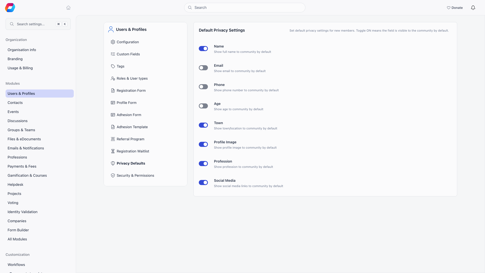
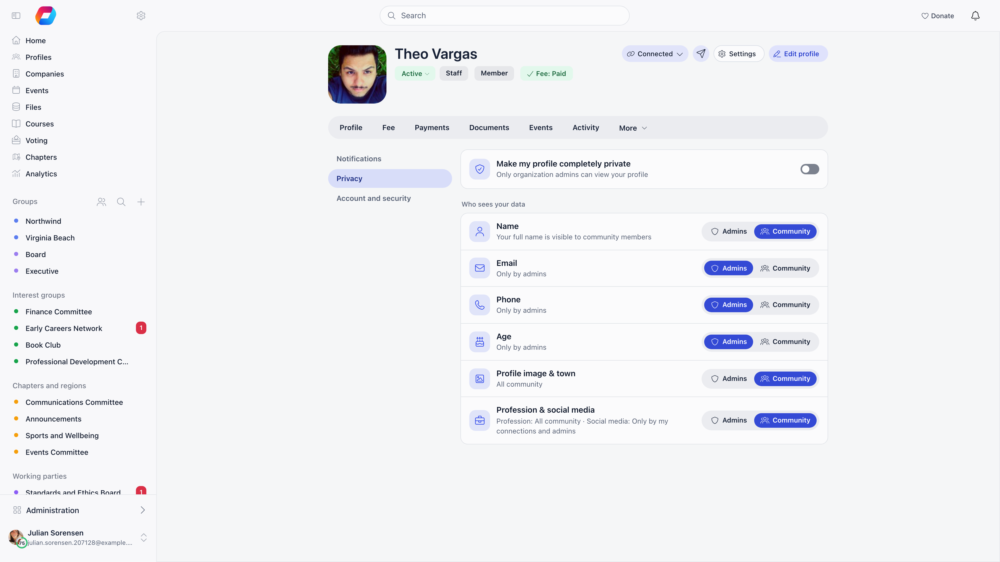

Privacy in Orgo works on two independent layers. You set organisation defaults that are copied onto each account the moment it is created, and every member then owns their own settings from that point on. On top of both, three tenant-wide settings decide who is allowed to browse the member directory at all.

---

## Organisation defaults

**Settings** → **Modules** → **Users & Profiles** → **Privacy Defaults**. Only Orgo administrators can change it. Toggle ON means the field is visible to the community by default.

| Setting | Help text in the app |
|---|---|
| **Name** | Show full name to community by default |
| **Email** | Show email to community by default |
| **Phone** | Show phone number to community by default |
| **Age** | Show age to community by default |
| **Town** | Show town/location to community by default |
| **Profile Image** | Show profile image to community by default |
| **Profession** | Show profession to community by default |
| **Social Media** | Show social media links to community by default |

<Warning>
  These are a starting point, not a ceiling. The values are copied onto a member's own privacy record once, when the account is created. Changing them afterwards does not touch a single existing member, and nothing stops a member from switching a field back on that you defaulted to admin-only. If a field must never be visible to other members, remove it from the profile form rather than relying on the default.
</Warning>

---

## What a member controls

A member opens their own profile, then **Settings** → **Privacy**. Chapter admins and above and a parent managing a child's profile see the same panel.

The member panel groups fields more tightly than the admin defaults do: **Profile image & town** is one switch, and **Profession & social media** is another. Setting either one applies to both fields behind it. Each card shows its current state as "All community" or "Only by admins".

**Make my profile completely private** sits above the rest. Turning it on sets every field to private and greys the individual switches out. Turning it off sets every field back to visible.

---

## What each setting actually hides

This is what a signed-in member without HR or Financial permissions sees on someone else's profile.

| Setting is private | Effect |
|---|---|
| **Name** | Last name is cut to its initial and a full stop, and a multi-part first name is cut to its first part. "Maya Louise Marino" reads as "Maya M." |
| **Email** | Email address is blank. See also [Connections](#connections-and-contact-details) |
| **Phone** | Phone number, local number and country code are all blank. See also [Connections](#connections-and-contact-details) |
| **Age** | Age is blank |
| **Town** | Current town and home town are blank |
| **Profile image** | Photo is blank |
| **Profession** | Profession headline and industry are blank |
| **Social media** | Every social link is blank: TikTok, Telegram, Instagram, Facebook, Website, LinkedIn, Twitter, Signal, Bluesky |

Email, phone and social links have a second condition on top of their switches: see [Connections](#connections-and-contact-details) below.

Three things are hidden from ordinary members no matter how the switches are set: **date of birth**, **member card ID**, and the **identity verification record**. Age can still be shown, date of birth cannot.

Anonymous visitors and guest accounts get the strictest treatment. They see the shortened name and no email, phone, age, town, photo or profession, regardless of what the member chose.

<Note>
  **Make my profile completely private** does more than blank fields. The member is filtered out of member lists and directory queries entirely, and opening their profile URL returns "This profile is private" to anyone who is not allowed to see it.
</Note>

---

## Who sees the unredacted profile

Field-level privacy is skipped for:

- the member themselves;
- a parent who manages that member's profile through the family feature;
- organization admins;
- organization-wide HR managers and financial managers, because both imply the assistant-level HR read;
- chapter HR managers, parent-chapter HR managers, and chapter or parent-chapter financial managers over that member's local center, for the same reason.

A member without a chapter is reached only through the organization-wide rights, so a chapter admin or chapter HR manager gets no special view of them.

The private-profile master switch is narrower: it is overridden only by organization admins, organization-wide HR managers, chapter HR managers over the member's local center, and parent-chapter admins inside their regional scope. An accepted connection also opens the profile, see below.

<Warning>
  Financial permissions grant full profile visibility. If you appoint a treasurer at a local center, they can read every field on every member of that local center, privacy switches included.
</Warning>

---

## Connections and contact details

Members can connect with each other. An **accepted** connection (pending or declined ones count for nothing) changes two things for regular members:

- It opens the profile past the walls above. A connected member can open your profile even when **Make my profile completely private** is on, and even when **Restrict Profiles to Shared Local Centers** would otherwise keep them out. Minors stay hidden.
- It is the only way contact details are shown. A regular member sees another member's **email, phone and social links only when the two are connected**. Your per-field switches still win: a field you made private stays hidden from your connections too.

So with every switch on, a stranger still sees no email, phone or social links, and a connection sees them. Name, age, town, photo and profession follow their switches without needing a connection. Administrators and the other people listed under "Who sees the unredacted profile" do not need a connection.

---

## Directory-wide visibility

**Settings** → **Modules** → **Users & Profiles** → **Configuration**, section **Privacy & Visibility**. All three need an Orgo administrator to change.

| Setting | What it does |
|---|---|
| **Who Can See Members in General Groups** | Minimum permission needed to browse the full member list. Below it, a member must narrow the list by group, local center or profession first. Options: All Users, HR Local, HR Tenant, Admin Local, Admin Tenant. |
| **Who Can See Local Center Members** | Minimum permission needed to filter members by a given local center. Same options. |
| **Restrict Profiles to Shared Local Centers** | When on, a member can only open profiles of people they share a local center with, counting local centers reached through unit roles. Admins and regional admins are exempt. |

---

## Bulk export

Exporting members to CSV requires chapter HR manager rights at minimum, and the export is capped at 500 rows per page. A plain member cannot download the directory even for fields they are allowed to read on screen, so field visibility and bulk access are two separate controls.

---

## Related

- [Profile Fields](/platform/users/profile-fields) covers what data a profile holds in the first place
- [Custom Fields](/platform/users/custom-fields) has its own visibility and encryption options
- [Permissions](/platform/permissions) explains the permission levels named above
- [Identity Validation](/platform/identity-validation) covers ID documents, which privacy switches do not govern
- [Account Deletion](/platform/users/deletion-of-account) is the permanent option
