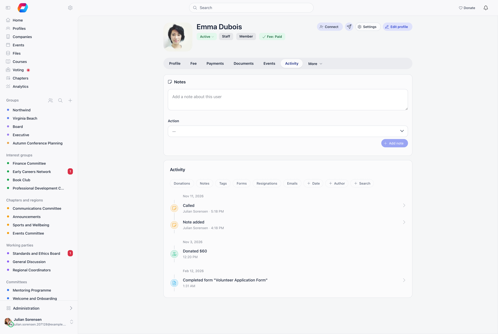
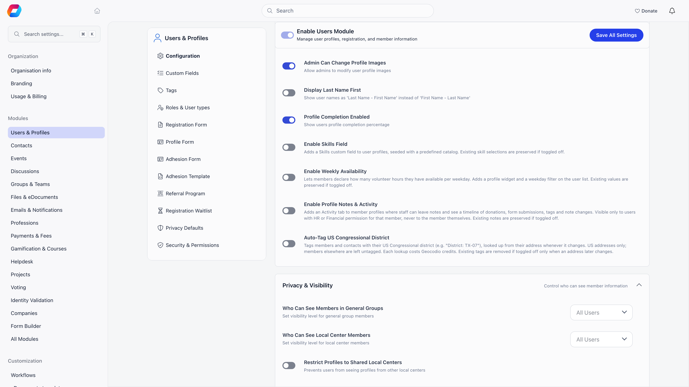
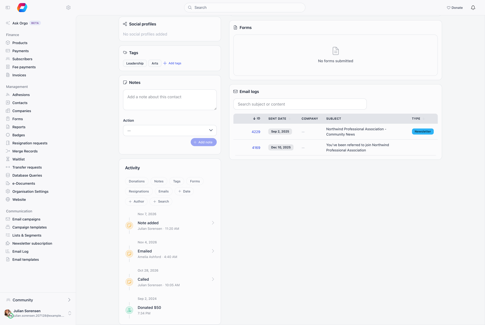
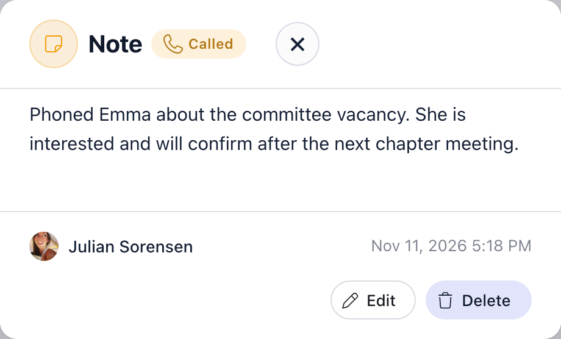
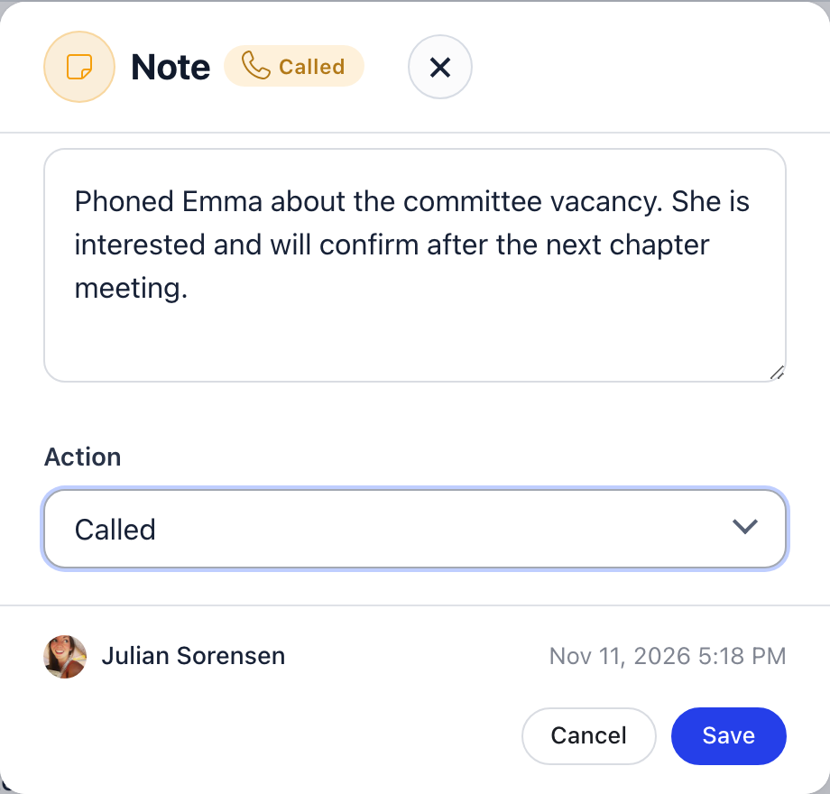
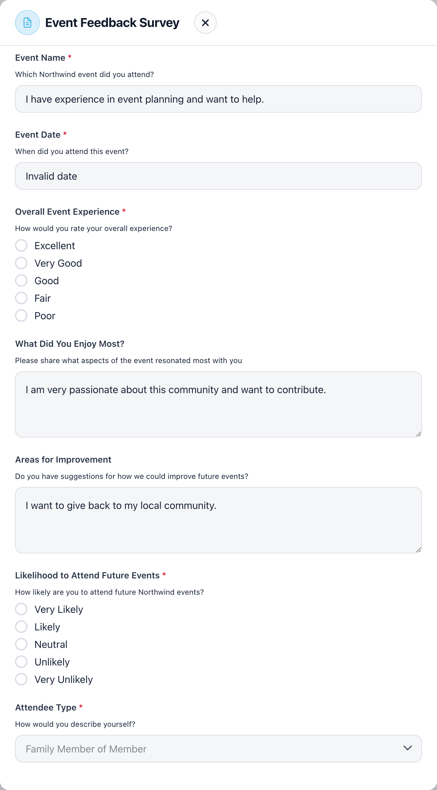
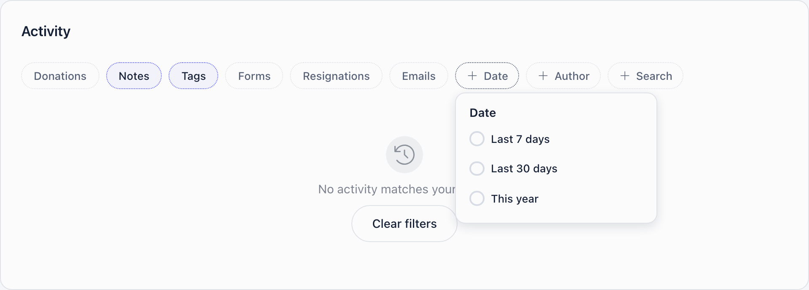
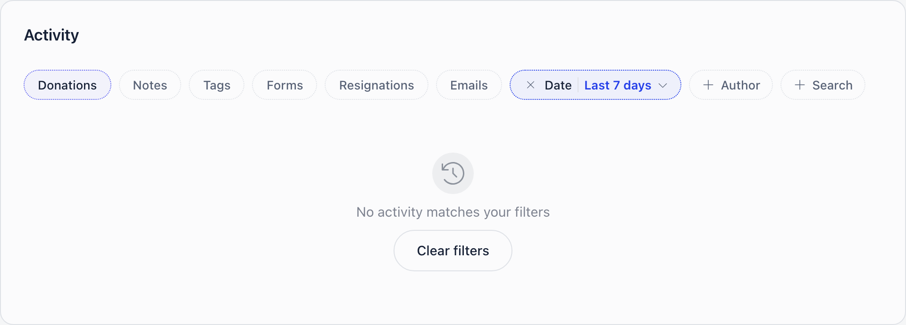

Activity is a single feed of what a person has done with you and what your staff
have written about them: donations, form submissions, tag changes, notes,
resignation requests and emails sent from their profile, all merged newest first. It is where your team keeps the running story of a member
or a contact, in the words of the people who spoke to them.

**Built for** the membership officer who needs to know what happened with
someone before calling them back. **Replaces** the shared spreadsheet of "who
spoke to whom" and the notes people keep in their own inbox.

Three further staff tabs sit beside it on the [member profile](/platform/users/member-profile):
**Forms** (every form the person submitted), **Audit Logs** (every recorded
change, with before and after values) and **Email Logs** (every email Orgo sent
them). Audit Logs and Email Logs have their own search box. They are described
under [Forms, Audit Logs and Email Logs](#forms-audit-logs-and-email-logs) below.

---

## Turning it on

**Settings** → **Modules** → **Users & Profiles** → **Configuration** →
**Enable Profile Notes & Activity**. It needs organization admin permission and it is **off**
until you switch it on.

The setting is a real gate, not a way of hiding a tab. Every endpoint behind the
feature checks it, so with it off nobody reaches the feed or the notes, whatever
they type into the address bar or call from the API.

<Note>
Switching it back off deletes nothing. Notes stay in the database, and they
reappear exactly as they were, with their authors and dates, when the setting
goes back on.
</Note>

---

## Who can see it

Two conditions have to hold at once: the setting is on, and you hold **HR** or
**Financial** permission over the person you are looking at. Organization admin permission
covers everybody. Contacts use the identical gate.

| | Activity | Forms | Audit Logs | Email Logs |
|---|---|---|---|---|
| Permission | `HR_LOCAL` or `FINANCIAL_LOCAL` over that person, or `ADMIN_TENANT` | `HR_LOCAL` or `FINANCIAL_LOCAL` over that person, or `ADMIN_TENANT` | `ADMIN_TENANT` only | `ADMIN_TENANT` only |
| Needs a setting switched on | Yes, **Enable Profile Notes & Activity** | No | No | No |
| What it shows | Donations, form submissions, tags and notes | The forms the person submitted, newest first | Every recorded change, with before and after values | Every email Orgo sent to the person |
| Where the tab is | In the tab row | Under **More** | Under **More** | Under **More** |
| Exists on contacts | Yes, as the Notes and Activity cards | Yes, as the Forms card | No | Yes, as the Email logs card |

So the tabs answer different questions for different people. A chapter
secretary with `HR_LOCAL` gets Activity and Forms on their own chapter's members
and never sees the two log tabs. Someone auditing a disputed profile edit wants
Audit Logs, and only a tenant administrator has it.

**More** is the control at the end of the tab row. It lists the staff tabs you
can open on this profile. Choosing one shows it as the last tab in the row,
replacing any tab you chose from the menu earlier, and the menu then offers the
others. Audit Logs and Email Logs share one tab, so only one of them is open at
a time.

<Warning>
Staff who hold HR or Financial permission get the Activity tab on **their own
profile** as well, so they can read the notes colleagues have written about
them. Treat notes as something the subject may eventually read, and keep
anything genuinely confidential out of them. The setting's own help text is more
reassuring than the behaviour, so do not rely on it.
</Warning>

---

## Where it lives

On a **member profile**, Activity is a tab in the tab row. The note composer sits
at the top of the tab and the feed underneath it.

On a **contact record**, there is no tab strip, so Notes and Activity are two
stacked cards in the body of the record, below Tags. They behave the same way.

---

## What appears in the feed

Six kinds of entry, merged into one list, newest first.

| Entry | Where it comes from | What it says | Opens |
|---|---|---|---|
| **Donation** | A successful payment on a donation product, or a payment flagged as a split donation | "Donated 50 usd". No author | No |
| **Form** | A form the person submitted | 'Completed form "Volunteer Application Form"'. No author | Yes, the answers |
| **Note** | A note your staff wrote | "Note added" or "Note modified", or **Called** or **Emailed** when the note carries that action, with the author and the time | Yes, the note |
| **Tag** | A tag added to or removed from the profile | 'Tag "Leadership" added' or 'Tag "Sports" removed', with who did it | No |
| **Resignation** | A resignation request made, approved, rejected or withdrawn | "Resignation request submitted", "approved by Name", "rejected by Name" or "withdrawn" | No |
| **Email** | An email somebody sent from the **Send an email** button on the profile | 'Email "Subject line" sent', with who sent it | No |

A further row appears once a note is deleted: **Note removed**, recording that
something was there. It carries no text and it does not open, because the text
is gone. When a member's personal ID number changes, the feed also shows "Personal
ID number changed on profile" (or "during donation") without the number itself;
that row has no type chip and shows only while no type chip is selected.

Donations and form submissions never carry an author, because they are things
the person did rather than things somebody did to their record. Tag changes are
recorded wherever a tag is added or removed through the app, which includes
workflow automations and the public newsletter signup form. Nobody is signed in
for those, so they appear with **no author name** against them. Bulk CSV imports
write tag links directly and produce no entry at all.

---

## What never appears

**Profile field edits are deliberately absent.** Somebody changing a member's
email address or town writes nothing to Activity. Those belong in the
[Activity Log](/platform/logs), which stores the old value beside the new one,
and they are reachable from the **Audit Logs** tab on the same profile.

Also absent, and not planned for this feed: fees and any payment that is not a
donation, event registrations, emails sent or received, logins, e-documents,
roles, permission changes, custom field changes and badges. Payments have the
[Payments tab](/platform/users), emails have the **Email Logs** tab and the
[email log](/platform/emails/email-log), and everything else with an audit trail
is in **Audit Logs**.

---

## Notes

### Writing one

Type into the composer at the top of the tab, or the Notes card on a contact,
and press **Add note**. A note is capped at **512 characters**, and an empty or
whitespace-only note is refused.

The optional **Action** select marks what the note records: **Called** or
**Emailed**. Leave it blank for a plain note. When it is set, the feed shows the
action as the entry's label and as a badge on the note itself, so a run of calls
is readable at a glance without opening anything.

### Reading, editing and deleting

The composer only writes. Everything else happens in the feed: click a note
entry and it opens in a modal with the full text, the action badge, the author
and the time.

**Edit** turns the same modal into a form: the text becomes editable and the
Action select comes back, so you can add, change or clear the Called or Emailed
marker after the fact.

**Edit** and **Delete** are offered to the note's **author** and to
Organization admin permission, and to nobody else. A colleague with the same HR permission can
read a note you wrote but cannot change or remove it.

<Note>
Notes that existed before this feature keep their original date and appear in
the feed at that point in time. Contact notes carried over from the older
single-box field have no author recorded, so only organization admins can edit or
delete those.
</Note>

---

## Opening a form submission

Clicking a **Completed form** entry opens the whole submission, read-only. Every
field on the form is shown, including the ones the person left blank, so you can
see what was asked as well as what was answered.

<Warning>
This is a wider audience than the [Forms](/platform/forms) module itself.
Anyone who can see the timeline can open the answers, so an HR administrator who
has no access to a form at all can still read that form's answers for a member
in their own chapter. If a form collects anything you would not show your
Chapter administrators, do not rely on form permissions to keep it from them.
</Warning>

---

## Filtering and searching

The chips above the feed narrow it. They combine, and they all apply at once.

| Filter | What it does |
|---|---|
| **Donations**, **Notes**, **Tags**, **Forms**, **Resignations**, **Emails** | Type chips. Select any combination; none selected means all six |
| **Date** | Three presets only: **Last 7 days**, **Last 30 days**, **This year**. There is no custom range picker |
| **Author** | One person from the list of people who appear in this feed, searchable by name |
| **Search** | Free text |

**Search matches note text and form names, and nothing else.** It does not match
tag names, donation amounts or author names, so searching for a colleague's name
finds notes that mention them rather than notes they wrote. Use the **Author**
filter for that. This is the Activity feed's search; the **Audit Logs** and
**Email Logs** tabs have separate search boxes with different rules, described
below.

When nothing matches, the feed says so and offers **Clear filters**, which
resets every chip at once.

---

## Reading the feed

Entries are grouped under a day heading, in reverse date order, and each row
shows its own time under the label. Days with nothing in them are skipped, so a
quiet year collapses to a handful of headings.

The feed loads **40 entries** at a time. When there are more, a **Load more**
button appears at the bottom and adds the next 40 below what you are already
looking at. Filters apply to the whole feed, not to the page on screen, so
narrowing by type or date searches everything and not only the first 40 rows.

---

## Forms, Audit Logs and Email Logs

### Forms

The **Forms** tab lists every form the person has submitted, newest first, ten
to a page. It is the same list as the form entries in the Activity feed, without
the notes and donations around it, so it is the quickest way to find one
submission.

| Column | What it shows |
|---|---|
| **Form** | The name of the form |
| **Submitted** | The date and time of the submission |
| **Status** | **Confirmed**, or **Awaiting confirmation** while the person has not yet confirmed the submission by email |

Clicking a row opens the answers, read-only, in the same window the Activity
feed uses, so the [warning above](#opening-a-form-submission) about who can read
answers applies here too. An empty list reads "No forms submitted". The list is
for staff only: a member without `HR_LOCAL` or `FINANCIAL_LOCAL` gets no Forms
tab, not even on their own profile. It does not depend on the **Enable Profile
Notes & Activity** setting.

### Audit Logs

**Audit Logs** is the per-member view of the organisation's
[Activity Log](/platform/logs): every recorded change to this profile, newest
first, twenty to a page. It needs `ADMIN_TENANT`.

| Column | What it shows |
|---|---|
| **ID** | The log entry number |
| **Date** | When it happened |
| **Action** | What was done, for example update or remove |
| **Changes** | The first field that changed, and how many more, such as "Email +2" |
| **Author** | Who made the change, linking to their profile; a dash when nobody was signed in |

Click a row to see what changed. The window lists each **Field** with its
**Value before** and **Value after**, so you can read an edit as old value next
to new value. If an entry recorded no values it says "No details available". A
change to the personal identification number opens its own view, and only
`HR_TENANT` or `FINANCIAL_TENANT` can reveal the stored value there.

The search box above the table, **Search action, details or author**, narrows
the list on the server. It looks in three places: the action, the recorded
details (which include the before and after values, so you can search for an old
email address or town), and the first and last name of the author. Type at least
two characters; the list updates a moment after you stop typing, and the page
returns to the first page. The search only ever narrows what this member's list
already shows. With no match the tab says "No logs match this search"; with no
entries at all it says "No logs available".

### Email Logs

**Email Logs** lists the emails Orgo sent to this person, the same entries as the
organisation-wide [email log](/platform/emails/email-log) narrowed to one
member. It needs `ADMIN_TENANT`. Its search box, **Search subject or content**,
matches the subject and the body of each email, again from two characters, and
narrows the member's list only. The same search box is on the organisation-wide
email log page.

---

## Common questions

<AccordionGroup>
  <Accordion title="The Activity tab is not there">
    Two gates, and both have to pass. First, **Enable Profile Notes & Activity**
    under **Settings** → **Modules** → **Users & Profiles** →
    **Configuration**. It is off by default, and a tenant administrator has to
    switch it on once for the whole organisation.

    Second, your permission over the person you are looking at: Chapter HR permission or
    Chapter financial permission on their chapter, or organization admin permission. Chapter event manager permission,
    Chapter communication manager permission and chapter admin permission on their own are not enough.

    Do not use the **Audit Logs** tab as a guide. That one asks for
    `ADMIN_TENANT` and nothing else, so seeing Audit Logs but not Activity means
    the setting is off, and seeing Activity but not Audit Logs is entirely normal
    for a chapter administrator.
  </Accordion>

  <Accordion title="Where are the Forms, Audit Logs and Email Logs tabs?">
    Open **More** at the end of the profile's tab row. Forms appears for staff with
    `HR_LOCAL` or `FINANCIAL_LOCAL` over the person, Audit Logs and Email Logs for
    `ADMIN_TENANT`. Picking one shows it as the last tab in the row; Audit Logs and
    Email Logs take turns in the same tab.
  </Accordion>

  <Accordion title="How do I find which change altered a member's email address?">
    Open **More** → **Audit Logs** on the member's profile and type the old or the
    new address into **Search action, details or author**. Open the matching row
    and read the **Field**, **Value before** and **Value after** table. The
    **Author** column says who made the change.
  </Accordion>

  <Accordion title="How do I find an email we sent a member?">
    Open **More** → **Email Logs** on the profile and type a word from the subject
    or the message into **Search subject or content**. Two characters are enough
    to start the search.
  </Accordion>

  <Accordion title="An entry has no author name">
    Expected for several kinds of entry. Donations and form submissions never
    have one, because they record something the person did rather than a change
    somebody made.

    Tag changes have one only when a signed-in person made them. A workflow
    automation adding a tag, or someone subscribing through the public
    newsletter form, has nobody signed in to attribute the change to, so the
    entry lands with the tag name and the time but no author.

    Contact notes carried over from the older single-box notes field also show
    without an author, and those can only be edited or deleted by an
    Organization admin permission.
  </Accordion>

  <Accordion title="I can see notes colleagues wrote about me">
    That is how it works, not a fault. The tab appears on every profile you hold
    HR or Financial permission over, and your own profile is one of them.

    The setting's help text claims the feature is never visible to the member
    themselves. That holds for ordinary members, who have no HR or Financial
    permission and get no tab. It does not hold for staff. Brief your team on
    that before you switch the feature on, and keep anything sensitive about a
    colleague out of the notes field.
  </Accordion>

  <Accordion title="A note was deleted and there is still a row for it">
    Deleting a note leaves a **Note removed** entry in its place, with the time
    and the person who removed it, but no text: the text is gone rather than
    hidden, and the row does not open.

    The deletion is also written to the [Activity Log](/platform/logs) as a
    **remove** action, so a tenant administrator can see it there alongside
    everything else that happened that day. Neither record brings the text back,
    so treat deletion as final.
  </Accordion>
</AccordionGroup>

---

## Related

- [Member Profile](/platform/users/member-profile) - the profile the Activity tab sits on
- [Members](/platform/users) - the member directory
- [Contacts](/platform/contacts) - the same notes and feed on a contact record
- [Activity Log](/platform/logs) - profile field edits, with before and after values
- [Permissions](/platform/permissions) - the HR and Financial permissions named here
- [Forms](/platform/forms) - the module that owns the submissions this feed links to
- [Donations](/platform/fees/donations) - where the donation entries come from
