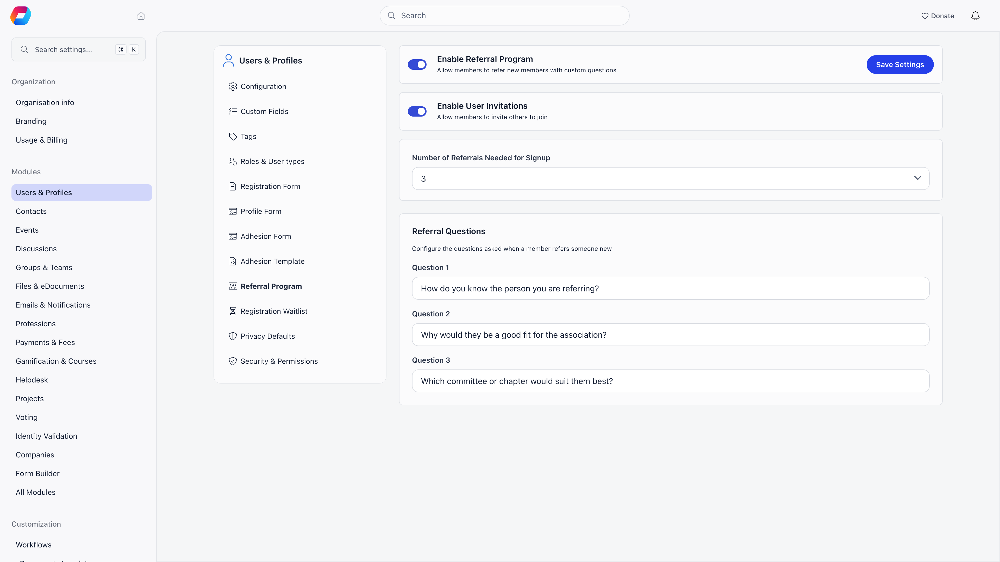

The Referral Program is a vouching gate on new registrations. Someone signs up
normally, then has to collect a set number of vouches from existing members before
their account is activated. Each voucher answers three questions you write, and
those answers stay on the new member's profile.

**Built for** membership organisations that admit people on the word of existing
members: professional networks, associations with sponsorship rules, alumni bodies.
**Replaces** the email thread where two board members confirm they know the
applicant.

<Note>
This is not the same feature as [Invitations](/platform/users/invitations).
Invitations are an existing member reaching out to someone new. The referral
program is other members vouching for someone who has already registered. They are
configured on the same settings page but work independently.
</Note>

---

## Setting it up

**Settings** → **Modules** → **Users & Profiles** → **Referral Program**. Only Orgo administrators can change it.

| Setting | What it does |
|---|---|
| **Enable Referral Program** | Turns vouching on and adds the referral cards to member profiles. |
| **Number of Referrals Needed for Signup** | **None**, or a number from 1 to 10. This is the gate: **None** means nobody is held for vouching. |
| **Referral Questions** (Question 1, 2, 3) | The three free-text questions every voucher answers. All three are required before **Save Settings** is enabled. |

Both switches have to be considered together: the program only holds new signups
when **Enable Referral Program** is on **and** the number is 1 or more. With the
number left at None, the program is on but nothing is gated.

Write questions that ask for something concrete, for example "How long have you
known this person?", "In what capacity have you worked with them?", "Why should
they be a member?". The answers are stored verbatim and are visible on the
profile, so they double as your admission record.

---

## What happens to a new signup

<Steps>
  <Step title="They register and confirm their email">
    Registration itself is unchanged: your normal registration form, the usual
    email confirmation code.
  </Step>
  <Step title="Their account is held">
    Once the email is confirmed, their status becomes **Awaiting referral** and a
    referral record with a unique link is created for them. They cannot sign in
    while they are in this state.
  </Step>
  <Step title="They receive their referral link">
    An email tells them how many referrals they need and gives them a link of the
    form `https://<your app host>/refer/<code>`. The confirmation screen shows the
    same link with a copy button and the message that they need referrals from N
    members of your community.
  </Step>
  <Step title="Members vouch">
    Anyone signed in who opens that link sees the applicant's name, answers your
    three questions and sends. One member can only vouch once for the same
    applicant. Once the applicant has all the referrals they need, the link shows a
    notice saying so instead of the form, and a vouch that is refused shows the
    reason on screen.
  </Step>
  <Step title="The gate opens">
    When the number of vouches reaches the configured number, the account is
    activated, or set to Unapproved if **Manual Approval** is on. The applicant is
    emailed that they can proceed, and administrators are emailed too.
  </Step>
</Steps>

Every single vouch, not just the last one, emails all tenant administrators with
the applicant's name, the voucher's name and the progress so far, for example 2 of
3. That email has its own switch, **Referral received - Admin Notification**, under
**Referrals** at **Settings** → **Modules** → **Emails & Notifications** → **Emails**, next to
the applicant's own referral emails.

<Warning>
Someone whose account is awaiting referral cannot log in. Attempting to sign in
returns them to their referral link rather than the dashboard. Plan for applicants
sitting in this state for as long as it takes their contacts to respond.
</Warning>

---

## Who can vouch

| Route | Who | Where |
|---|---|---|
| The applicant's referral link | Any signed-in member of your organisation | `/refer/<code>` |
| Vouch on a member's behalf | Staff with HR_LOCAL over the **voucher's** local center, on the profile of a voucher whose own account is Active | **Referrals** tab on the voucher's profile, under **Choose person waiting for referral** |

On that tab, staff pick the applicant, answer the three questions for the
voucher and press **Submit referral**. The vouch is recorded under the name of
the member whose profile they are on, not under the staff member's own name.
The applicant picker lists the ten most recent people awaiting referral as
**Latest awaiting referrals** buttons and has a member search restricted to
applicants awaiting referral, so staff can work through the queue without
collecting links. **Submit referral** stays disabled until an applicant is
picked and all three answers are filled in.

Chapter HR managers (and organization-wide HR managers) can also help an applicant
along. On the **Referrals** tab of a member who is awaiting referral, a **Referral
link** card shows that applicant's link with a **Copy** button, so staff can send
it to the people who will vouch. It works for members whose status was set to
Awaiting referral by hand, who have no link yet: opening the tab creates it.

Vouching is not anonymous. Each vouch is stored with the voucher's name and their
three answers, and appears on both profiles: under **Referred by** on the
applicant's Referrals tab and under **Referrals given** on the voucher's. There is
no rating, score or approval step on a vouch: submitting one counts.

---

## Members you add yourself are exempt

The gate only applies to self-signup. A member created by a signed-in
administrator keeps the status you configured for admin-created users and gets no
referral record, so you can always add people directly. Imported members are not
gated either.

<Warning>
Completion is checked when a vouch is submitted and compares the count against the
current requirement exactly. Lowering the requirement afterwards does not release
people who already have more vouches than the new number. If you change the
number while applicants are mid-flow, activate the affected people from the member
directory by setting their status to Active.
</Warning>

---

## Seeing referral activity

On a member's **Referrals** tab:

- **Referred by** shows every vouch that member received, with the voucher and the
  full answers. When there are none it reads "No referrals received at this time".
- **Referrals given** shows every applicant that member vouched for, with the same
  answers. When there are none it reads "No referrals given at this time".

**Where the tab is.** On your own profile **Referrals** is one of the tabs. On
someone else's profile it is not in the tab row: open **More** at the end of the
row and choose **Referrals**. For the vouching cards it is offered to staff with
HR_LOCAL over that member, while the referral program is on. When **Enable User
Invitations** is on, the same tab also holds the invitation link, the invite by
email box and the invitation history for members allowed to send invitations;
see [Invitations](/platform/users/invitations).

Organisation-wide, the statistics page carries a **Referrers** leaderboard ranking
members by completed referrals over 7 days, 30 days or all time, showing the top 20
with an option to expand to 50. That card is driven by the invitation link
mechanism and appears when **Enable User Invitations** is on. A local center
analytics page shows the same card for its own members.

If the Gamification module is running with tiers, completing a referral awards
points to the member who referred the newcomer through an invitation link. The
amount comes from your gamification point rules and defaults to 100.

---

## Common scenarios

<AccordionGroup>
  <Accordion title="We want vouching, but people should not be locked out while they wait">
    There is no partial mode: while the requirement is 1 or more, applicants cannot
    sign in until they reach it. If you want new people to have access immediately
    and be reviewed afterwards, leave the requirement at None and use **Manual
    Approval** or [Adhesion](/platform/users/adhesion) instead.
  </Accordion>

  <Accordion title="An applicant lost their referral link">
    The link is stable and can be regenerated by attempting to sign in: the login
    response returns them to their referral page. Chapter HR managers can copy it
    from the **Referral link** card on the applicant's Referrals tab. Administrators can also find the
    applicant in the member directory by filtering status to Awaiting referral, and
    vouch for them directly from the Referrals tab if they are a chapter HR manager.
Staff can also copy the applicant's link from the applicant's own Referrals tab and
send it on.
  </Accordion>

  <Accordion title="Nobody is vouching and applications are piling up">
    Filter the member directory by the Awaiting referral status to see the backlog.
    Chapter HR managers can clear it from the Referrals tab, and any member can
    still be activated directly by changing their status to Active, which bypasses
    the gate. A second vouch from the same member for the same applicant is
    rejected, so the backlog cannot be cleared by one person vouching repeatedly.
  </Accordion>

  <Accordion title="Where do I see who vouched for a member?">
    Open the member's profile, then **Referrals** (under **More** on someone
    else's profile). **Referred by** lists each voucher with the answers they gave
    to your three questions. **Referrals given** is the reverse: the applicants
    this member vouched for.
  </Accordion>

  <Accordion title="Can an administrator vouch for an applicant?">
    Yes, in the voucher's name. Staff with HR_LOCAL over an Active member open that
    member's **Referrals** tab, choose the applicant under **Choose person waiting
    for referral**, fill in the three answers and press **Submit referral**. The
    vouch counts toward the applicant's total and appears on both profiles as the
    member's own, so only do this with the voucher's agreement.
  </Accordion>

  <Accordion title="Do the answers stay private?">
    No. They are shown on the applicant's profile and on the voucher's profile to
    anyone who can see those tabs. Do not ask for anything you would not want the
    applicant to read.
  </Accordion>
</AccordionGroup>

---

## Related

- [Member Profile](/platform/users/member-profile) - the profile and its Referrals tab
- [Invitations](/platform/users/invitations) - members bringing in new people by email or link
- [User Statuses](/platform/users/statuses) - what Awaiting referral and Unapproved block
- [Registration Form](/platform/users/registration-form) - the signup that precedes vouching
- [Adhesion](/platform/users/adhesion) - a formal application instead of vouching
- [Permissions](/platform/permissions) - what chapter HR managers and organization admins can do
